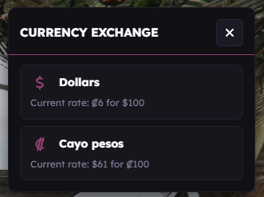

# Wqzx Exchanger

A FiveM currency exchange resource. Players interact with an exchange clerk to trade dollars for Cayo pesos or convert pesos back to dollars. The menu shows the current rate in each direction before the player confirms the exchange.

## Preview



## Requirements

- FiveM with [OneSync](https://docs.fivem.net/docs/scripting-reference/onesync/) enabled.
- [ox_lib](https://github.com/communityox/ox_lib) for menus, dialogs, and progress bars.
- [ox_target](https://github.com/communityox/ox_target) for clerk interactions.
- [ox_inventory](https://github.com/communityox/ox_inventory) for currency items and transfers.

## Installation

1. Place the `wqzx_exchanger` folder in your server's `resources` directory.
2. Start the dependencies before the exchanger in `server.cfg`.

   ```cfg
   ensure ox_lib
   ensure ox_target
   ensure ox_inventory
   ensure wqzx_exchanger
   ```

## Configuration

Edit [config.lua](config.lua) and run `restart wqzx_exchanger` in the server console to apply changes.

| Setting | Description |
| --- | --- |
| `Config.Locale` | `en` for English (default) or `cs` for Czech. |
| `Config.Notify` | `ox_lib` (default), `esx` for ESX, `qb` for QBCore, or `none` to disable exchanger notifications. If the selected framework is unavailable, the resource uses `ox_lib`. |
| `Config.npc` and `Config.target` | Set the clerk model, spawn coordinates, and interaction zones. Keep the NPC and target coordinate lists in the same order. |
| `Config.rates.dollar` and `Config.rates.cayo` | Set the currency item names and the minimum and maximum amounts paid per 100 units of the source currency. The default items are `money` and `black_money`, respectively. |
| `Config.minExchange` | Minimum amount a player can exchange. Defaults to 100. |
| `Config.updateInterval` | Seconds between rate refreshes. Defaults to 60. |